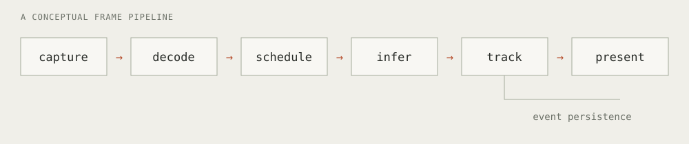

A real-time vision pipeline includes capture, decoding, inference scheduling, tracking, event persistence, and result presentation. Delays in any of these stages can affect application responsiveness independently of model execution time.

In one documented single-feed test from my engineering work, the input was a **1080p stream at 25 FPS**, while the detector processed approximately **1.3 frames per second**. Profiling identified repeated SQL aggregation over a detector-event journal backlog on the tracking path. Removing that repeated work improved measured detector throughput to approximately **19.9 FPS**.

## Pipeline stages

The following diagram summarizes the stages of a representative processing pipeline:



This diagram is conceptual. Real implementations overlap stages and use queues. That overlap is exactly why a single “FPS” number can be misleading: different stages may process different numbers of frames.

A detector can be fast on an isolated image while the application accumulates stale work elsewhere. Event storage can look unrelated to inference until a synchronous query sits on the critical path.

## Measurement definitions

| Measurement             | Question it answers                                      |
| ----------------------- | -------------------------------------------------------- |
| Source frame rate       | How frequently does the source produce frames?           |
| Detector throughput     | How many frames receive a detector result per second?    |
| Publishing latency      | How long does the measured publishing path take?         |
| Send-to-browser latency | How long does video transport take to reach the browser? |

The single-feed test measured these changes:

| Metric              |   Before |     After |
| ------------------- | -------: | --------: |
| Detector throughput | ~1.3 FPS | ~19.9 FPS |
| Publishing latency  |  ~987 ms |   ~107 ms |

These are measurements from one test feed and configuration. They do not establish capacity across multiple cameras, other models, or different hardware. In particular, publishing latency is not interchangeable with the time from an event in the physical world to a visible annotated frame.

## Timing boundaries

For a frame captured at time $t_c$ and presented at time $t_p$, one possible definition of end-to-end frame age is

$$
L_{\text{frame}} = t_p - t_c.
$$

That definition is only usable when the two timestamps have a meaningful relationship. If clocks differ between machines, the measurement also needs clock synchronization or a carefully designed round-trip or visual test.[^clocks]

Inside a single Python process, a monotonic clock can help time a specific stage. This illustrative example measures only the function call, including any work it blocks on:

```python
from time import perf_counter_ns

started = perf_counter_ns()
tracks = update_tracks(detections)
elapsed_ms = (perf_counter_ns() - started) / 1_000_000

record_stage_latency("tracking", elapsed_ms)
```

The instrumentation is useful only when its label matches its scope. Calling the value `end_to_end_latency` would conceal everything that happened before and after the function. GPU operations can also be asynchronous, so timing a host-side launch may require explicit synchronization to measure completed device work.[^cuda]

## Queue management and frame freshness

For live systems, throughput and freshness are related but different goals. If incoming work consistently exceeds processing capacity, an unbounded queue grows and the output becomes progressively older.

Persistent sessions, bounded frame brokering, per-device scheduling, and timestamped frames give the system explicit places to manage that pressure. The right drop or sampling policy depends on the task: a live view and an evidence recorder need different guarantees.

In this case, removing unnecessary database work was the direct change behind the reported improvement. Hardware-aware adapters and scheduling are part of the broader engineering context, but they should not be credited as the sole cause of this particular result.

## Engineering implications

Model optimization should be informed by measurements of the surrounding pipeline. Detector throughput, presentation rate, and transport delay should be reported separately, together with the source, hardware, and configuration required to interpret a comparison.

The [case study](../../projects/realtime-vision/) describes the engineering work and measurement limits. The separate [video transport case study](../../projects/edge-video/) uses a local synthetic-source test; its latency figures answer a different question.

[^clocks]: Two monotonic clocks on different hosts do not automatically share an origin. The timing scheme must account for that before subtracting their readings.

[^cuda]: See the [PyTorch CUDA semantics documentation](https://docs.pytorch.org/docs/stable/notes/cuda.html#asynchronous-execution) for asynchronous execution and timing considerations.
